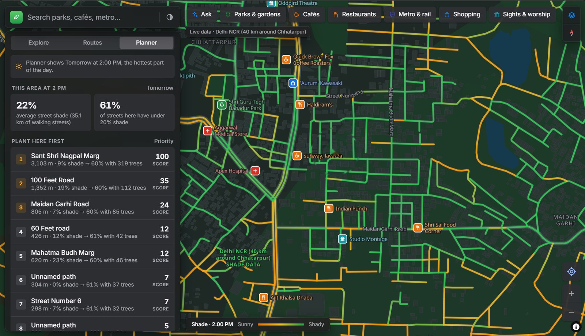
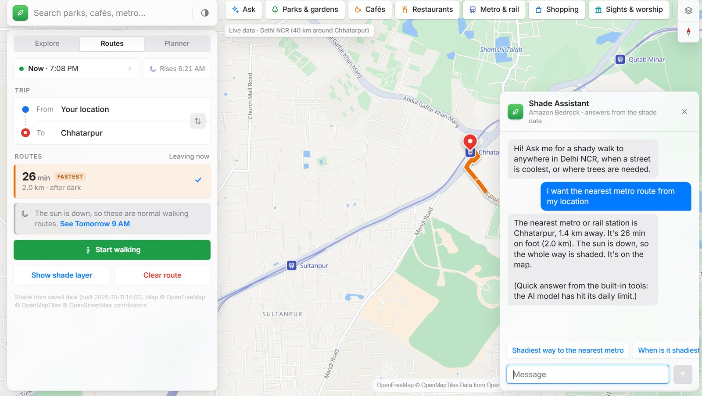
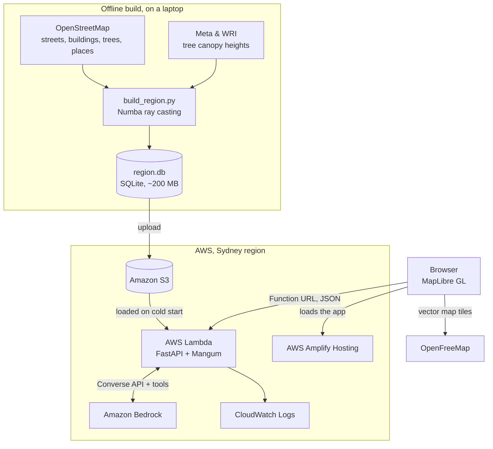

<div align="center">

# 🌳 Shade Routes

**Find the shadiest way to walk in Delhi NCR, and see where new trees would help most.**

Every street within 40 km of Chhatarpur, with its shade for every hour of every week of the year.

[**Open the live app →**](https://main.dczwtg7so4eis.amplifyapp.com/app.html)




</div>

## Why

In a Delhi summer, a 15-minute walk at 2 PM can be dangerous, yet two streets side by side can feel completely different: one in the shade of buildings and old trees, the other in full sun. Map apps optimise for distance. **Shade Routes optimises for comfort.** It shows how shaded each street is at the time you'll walk, and picks a route that keeps you out of the sun without a long detour.

The same data answers a planning question too: **where would new trees help walkers most?**

## Features

| Feature | What it does |
|---|---|
| 🗺️ **Shade map** | Every street coloured from sunny to shady for any date and time, with a live sun position and direction. After sunset it switches back to a normal map. |
| 🚶 **Shady routes** | The fastest walk and the shadiest walk, side by side. The shadiest one is never more than 30% longer. Routes use footpaths and colony lanes, not just main roads, and redraw when you change the time. |
| 🧭 **Walking mode** | Follows you along the route, re-routes automatically if you leave it, and offers a cooler way when one opens up. |
| 🌱 **Planner** | Ranks the streets on screen by how much sun walkers get, weighted by how busy that kind of street usually is, and estimates how many trees would bring each one to 60% shade. |
| 🏷️ **IDs for unnamed paths** | Lanes and footpaths with no name get a stable ID such as `Lane G5FJ+2V`. It's a [Plus Code](https://maps.google.com/pluscodes/), so searching `G5FJ+2V Delhi` in Google Maps finds the spot. |
| 💬 **Shade Assistant** | Ask *"shadiest way to the nearest metro"* or *"where should trees go here?"*. It runs on Amazon Bedrock with tool calling, and falls back to built-in answers from the same data if the AI is unavailable. |
| 📍 **Places** | Parks, cafés, restaurants, metro stations, shops, sights and hospitals across the whole area, with offline search. |
| ⏱️ **Now or plan ahead** | Live mode follows the clock; plan-ahead mode takes any date and a 15-minute time slider. |
| 🌗 **Polished UI** | Light, dark and system themes, spring animations, a draggable bottom sheet on phones, keyboard shortcuts (`/` to search, `Shift+D` for theme), and reduced-motion support. |
| 📴 **Works offline** | On a laptop, the backend serves the saved shade data and a saved base map with no internet. |



## How it works

Shade is **precomputed offline** for 728 time slots (52 weeks × 14 daylight hours, 6 AM–7 PM) and packed into one SQLite file. At request time the server only looks values up and blends them, so even a small AWS Lambda answers quickly.



### 1. Computing shade (`build_region.py`)

The build runs in five resumable steps: `download → osm → prepare → shade → pack`.

1. **Streets.** OpenStreetMap streets are split into segments between junctions. Each segment gets an 8 m walking corridor, sampled every 5 m along three lines across it.
2. **Obstacles.** Buildings are rasterised on a **1 m grid** with heights from OSM `height` or `building:levels` tags, defaulting to 10 m. Tree cover comes from the [Meta & WRI high-resolution canopy height maps](https://registry.opendata.aws/dataforgood-fb-forests/) (trees from 3 m tall), plus mapped single trees.
3. **Sun.** Sun elevation and azimuth for every slot come from `pvlib`.
4. **Ray casting.** A **Numba-compiled kernel** marches from every sample point toward the sun across the height raster, up to 300 m. A point is in shade if it's under a building or canopy, or if a building between it and the sun rises above the sun line. Coarse 8×8 blocks let the kernel skip empty ground quickly.
5. **Scale.** The 40 km circle is cut into roughly 1,300 tiles of 2 km × 2 km, computed in parallel. The worker count adapts to free memory, finished tiles are written atomically, and the build can be stopped and resumed at any time. Checked against the original polygon-based method, the results agree within about 3 percentage points (r = 0.97).
6. **Packing.** Each segment stores 728 shade values as one byte each (0.5% steps), zlib-compressed, alongside its geometry, a spatial grid index and a walkability flag.

**Result:** 776,441 street segments (about 58,400 km of streets) covering nearly all of Delhi NCR in one ~200 MB file.

At request time, shade for any moment is **blended between the two nearest weeks and hours**.

### 2. Shady routing (`backend/region_engine.py`)

- The walking network includes footpaths, service roads and private colony lanes. Private lanes cost 25% extra, so a public road wins when it isn't a detour. Motorways and roads under construction are excluded.
- **Fastest route:** Dijkstra on distance.
- **Shadiest route:** Dijkstra on `distance × (1 + penalty × sun share)`, trying the strongest penalty first and accepting the first route that is at most **30% longer** than the fastest.
- After sunset every street counts as shaded, so you get the fastest route.

### 3. Planner

For the streets in view, the Planner works out how many metres of each street are in the sun at the chosen time. It multiplies that by a footfall weight for the street type (markets and main roads above lanes and tracks) and scales the result to a 0–100 score.

Tree estimates assume each new tree shades about 40 m² of the 8 m corridor, with at most one tree every 8 m on each side, aiming for 60% shade.

### 4. Shade Assistant (`backend/region_chat.py`)

The assistant uses the Amazon Bedrock **Converse API with tool use**. The model never invents numbers; it calls these tools on the same data the map uses:

| Tool | What it does |
|---|---|
| `search_places` | Finds a place by name. |
| `nearby_places` | Lists the nearest places of a kind. |
| `shady_route` | Plans the fastest and shadiest walks. |
| `shade_at` | Gives shade on a street, hour by hour. |
| `plant_priorities` | Lists where trees are needed most. |

Answers can also drive the app, for example opening a route or the Planner.

If a model is retired or over its quota, the assistant tries the next one. As a last resort it asks Bedrock which models the region offers. If none work, built-in answers cover the common questions, so the chat never just errors.

## Tech stack

| Layer | Tools |
|---|---|
| **Data pipeline** | Python, NumPy, Numba, pyosmium, Shapely, pyproj, rasterio, pvlib, GeoPandas/OSMnx (earlier per-area pipeline) |
| **Backend** | FastAPI, NetworkX, SQLite, Mangum |
| **Frontend** | MapLibre GL JS, plain HTML/CSS/JS (one file, no framework), Vite for the build |
| **AWS** | Lambda (Function URL), S3, Amplify Hosting, Bedrock, CloudWatch |
| **Map & data** | OpenStreetMap, OpenFreeMap vector tiles, Meta & WRI canopy height, Open-Meteo weather and air quality |

## AWS deployment

| Service | Role |
|---|---|
| **S3** | Holds `region.db`, about 200 MB. |
| **Lambda** | Runs the API: Python 3.12, 2 GB memory and 2 GB `/tmp`, behind a **Function URL**. On a cold start it downloads the database to `/tmp` and opens it read-only. |
| **Amplify** | Hosts the web app (`app.html`). |
| **Bedrock** | Runs the assistant (Amazon Nova 2 Lite by default). |
| **CloudWatch** | Collects logs. |

<details>
<summary><b>Step-by-step deployment</b></summary>

1. **Build the data** (see [Run it locally](#run-it-locally)), then upload `data/region/region.db` to an S3 bucket.
2. **Package the API:**
   ```bash
   cd backend
   python build_lambda.py        # creates shade-routes-api.zip with Linux wheels
   ```
3. **Create the Lambda function:** Python 3.12, x86_64, handler `main.handler`, 2048 MB memory, 2048 MB ephemeral storage, 60–90 s timeout. Upload the zip.
4. **Set environment variables:**

   | Variable | Example |
   |---|---|
   | `REGION_DB_S3` | `s3://your-bucket/region.db` |
   | `DATA_BUCKET` | `your-bucket` |
   | `REGION_MAX_ROUTE_KM` | `8` (longest walking route allowed) |
   | `BEDROCK_MODEL_ID` *(optional)* | `global.amazon.nova-2-lite-v1:0` |

5. **Permissions:** give the function's role read access to the bucket, and Bedrock access if you want the assistant.
6. **Function URL:** add one with auth `NONE`. Leave CORS off there, because the app already sends CORS headers.
7. **Frontend:** put the Function URL in `<meta name="shade-api" content="…">` in `frontend/public/app.html`, run `npm run build`, zip the contents of `dist/`, and deploy it with Amplify (*Deploy without Git*).

Responses are gzip-compressed and street-shade requests are limited in area, which keeps them under Lambda's 6 MB response limit.

</details>

## Run it locally

```bash
python -m venv .venv
.venv\Scripts\activate     # Windows; on macOS/Linux: source .venv/bin/activate
pip install -r backend/requirements.txt     # the API server
pip install osmium numba scipy requests pyproj shapely rasterio pvlib geopandas osmnx mercantile   # the data builder

python build_region.py      # 1–3 h the first time; Ctrl+C and re-run to resume
python offline_map.py       # optional: saves the base map for offline use

cd backend
uvicorn main:app --reload
```

Open **http://localhost:8000/app**. The interactive API docs are at **http://localhost:8000/docs**.

To build a different city, change `CENTER` and `RADIUS_M` in `region_config.py`. Builder options include `--workers N`, `--step shade`, `--from-step osm` and `--no-canopy`. More details are in [README_OFFLINE.md](README_OFFLINE.md).

## API

All times are Delhi time in ISO format, for example `2026-05-15T14:00+05:30`. Without `when`, the API uses the current time.

| Endpoint | Returns |
|---|---|
| `GET /api/region/info` | Area name, centre, radius, counts and the build date. |
| `GET /api/region/shade?west&south&east&north&when` | Street shade as GeoJSON for a box of up to about 3.5 × 3.5 km. |
| `GET /api/region/route?from_lat&from_lon&to_lat&to_lon&when` | The fastest and shadiest walks, with minutes and % shade. |
| `GET /api/region/planner?west&south&east&north&when` | Streets ranked for tree planting, with tree estimates. |
| `GET /api/region/places?q&lat&lon` | Offline place search. |
| `GET /api/region/nearby?lat&lon&cats&limit&offset` | Nearest parks, cafés, food, transit, shops, sights and health places. |
| `GET /api/region/street/{id}?date` | One street's shade for every hour of a day. |
| `POST /api/region/chat` | Assistant reply: `{answer, actions}`. |
| `GET /offline/tiles/{z}/{x}/{y}.pbf` | The saved base map, for offline use. |

## Project structure

```
shade-routes/
├── build_region.py         # builds data/region/region.db (download → osm → prepare → shade → pack)
├── region_config.py        # centre, radius, time slots, shade-model settings
├── offline_map.py          # saves base-map tiles and fonts for offline use
├── shade_lib.py            # shared shade functions (heights, canopy, sun position)
├── build_area.py, areas.py # earlier per-neighbourhood pipeline (Connaught Place, Chandni Chowk, …)
├── demand.py, priority.py, compare_areas.py
├── backend/
│   ├── main.py             # FastAPI app + Lambda handler (Mangum)
│   ├── region_engine.py    # shade lookup, routing, planner, Plus Code IDs
│   ├── region_api.py       # /api/region/* and offline map endpoints
│   ├── region_chat.py      # Bedrock assistant with tools and fallback
│   ├── engine.py, chat.py  # earlier per-area API
│   ├── build_lambda.py     # packages the Lambda zip
│   └── static/index.html   # the app, served at /app
└── frontend/
    └── public/app.html     # the same app, built with Vite and hosted on Amplify
```

## Challenges and what I learned

- **Speed.** Unioning shadow polygons for every hour was far too slow for 776k segments. Ray casting on a 1 m raster with Numba made a 40 km city-scale build possible on a laptop, and checking it against the original method kept it honest.
- **Running on a 16 GB laptop.** The first runs froze the machine. The builder now picks its worker count from free memory, runs at low priority, writes each tile atomically, and stops cleanly on Ctrl+C on Windows.
- **Lambda limits.** The 6 MB response cap led to gzip, compact GeoJSON and area limits. Storing the data as one read-only SQLite file in S3 avoided the need for a database server.
- **Walking routes that feel like walking.** The first version excluded private colony lanes, which pushed routes onto main roads. A small penalty instead of a ban fixed it.
- **AI in production.** Models retire, and new accounts can start with zero quota. The assistant now discovers working models itself and falls back to answering from the data, so the feature degrades gracefully instead of breaking.

## Data and attribution

- Map data © [OpenStreetMap](https://www.openstreetmap.org/copyright) contributors (ODbL).
- Map tiles from [OpenFreeMap](https://openfreemap.org), © [OpenMapTiles](https://openmaptiles.org).
- Tree canopy: [High Resolution Canopy Height Maps by WRI and Meta](https://registry.opendata.aws/dataforgood-fb-forests/) (CC BY 4.0).
- Weather and air quality: [Open-Meteo](https://open-meteo.com) (CC BY 4.0).
- Outside the saved area, search uses [Photon](https://photon.komoot.io) and routes use the [FOSSGIS](https://routing.openstreetmap.de) OSRM server.

Shade values are modelled estimates. Treat them as a guide, not a guarantee, especially near new construction or recently cut trees.

## Author

**Soham Mawai**, B.Tech Mathematics & Computing, NSUT · [LinkedIn](https://www.linkedin.com/in/soham-mawai-4b4ba8298/)
